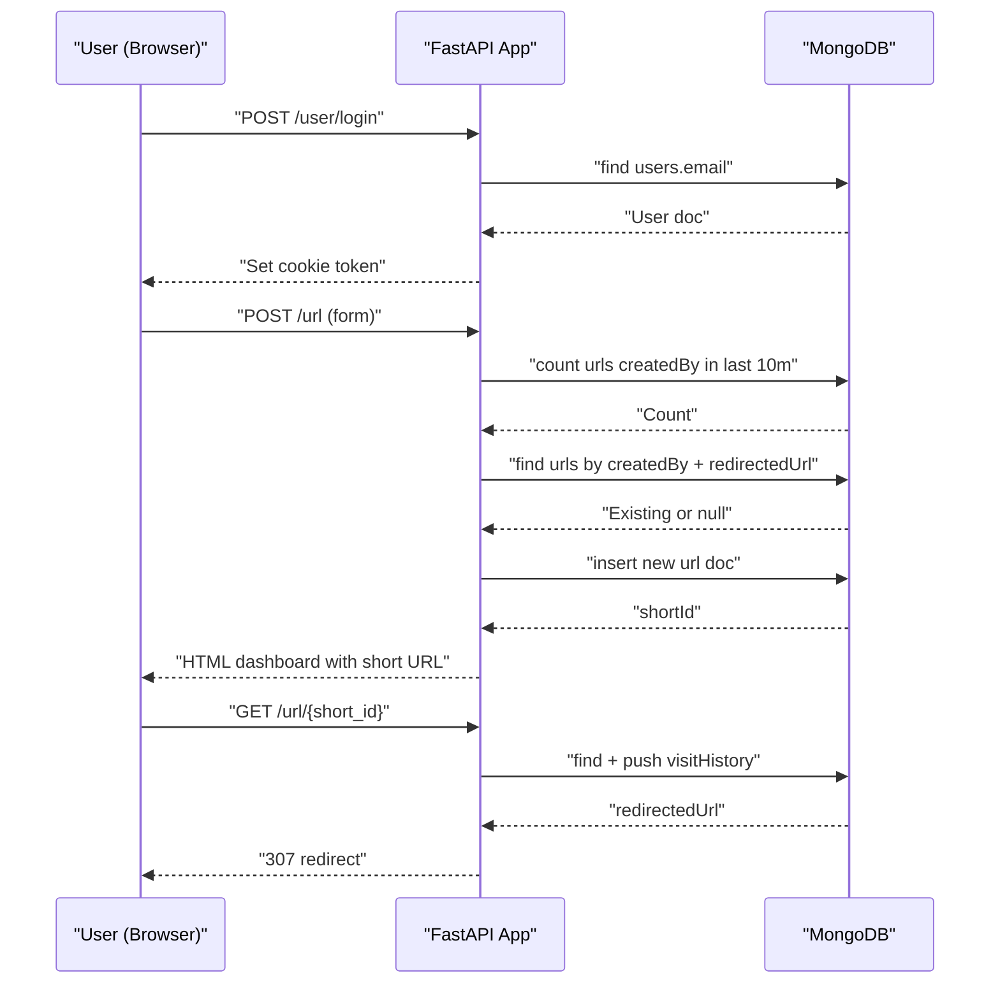
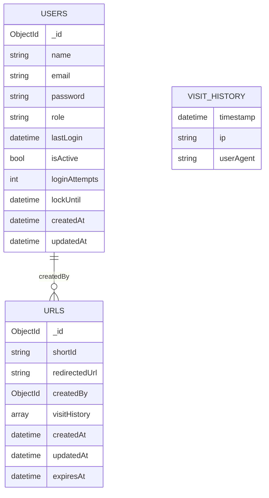
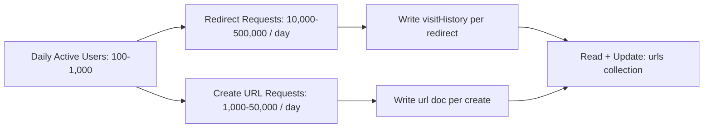

# Developer Documentation and Planning

## User Flow

```mermaid
flowchart TD
  A["Visitor"] --> B["Login Page (/login)"]
  B -->|POST /user/login| C["Auth Service"]
  C -->|Set cookie 'token'| D["Dashboard (/)"]
  A --> E["Signup Page (/signup)"]
  E -->|POST /user| C
  D -->|POST /url| F["Create Short URL"]
  F --> G["Dashboard Updated (shows short URL)"]
  D -->|GET /url/{short_id}| H["Redirect + Record Visit"]
  D -->|GET /admin/urls (ADMIN)| I["Admin URL List"]
  D -->|GET /logout| J["Clear cookie + Redirect /login"]
```

## Request Flow (Runtime)



## Database Collections (Expected Schema)



## Expected Load Model (Assumptions)

Assumptions: small personal project, 100 to 1,000 daily active users, 10 to 50 URLs per day per user, 1 to 10 clicks per URL per day.



## Sample Data

```json
// users
{
  "_id": "64f1c2...e91",
  "name": "Asha",
  "email": "asha@example.com",
  "password": "<bcrypt-hash>",
  "role": "USER",
  "lastLogin": "2026-03-19T08:10:11Z",
  "isActive": true,
  "loginAttempts": 0,
  "lockUntil": null,
  "createdAt": "2026-03-10T12:00:00Z",
  "updatedAt": "2026-03-19T08:10:11Z"
}

// urls
{
  "_id": "64f1c2...f02",
  "shortId": "a1B2c3D4",
  "redirectedUrl": "https://example.com/very/long/url",
  "createdBy": "64f1c2...e91",
  "visitHistory": [
    {
      "timestamp": "2026-03-19T08:20:02Z",
      "ip": "203.0.113.10",
      "userAgent": "Mozilla/5.0"
    }
  ],
  "createdAt": "2026-03-19T08:19:50Z",
  "updatedAt": "2026-03-19T08:20:02Z",
  "expiresAt": null
}
```
