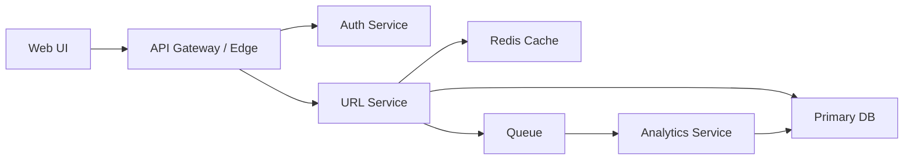
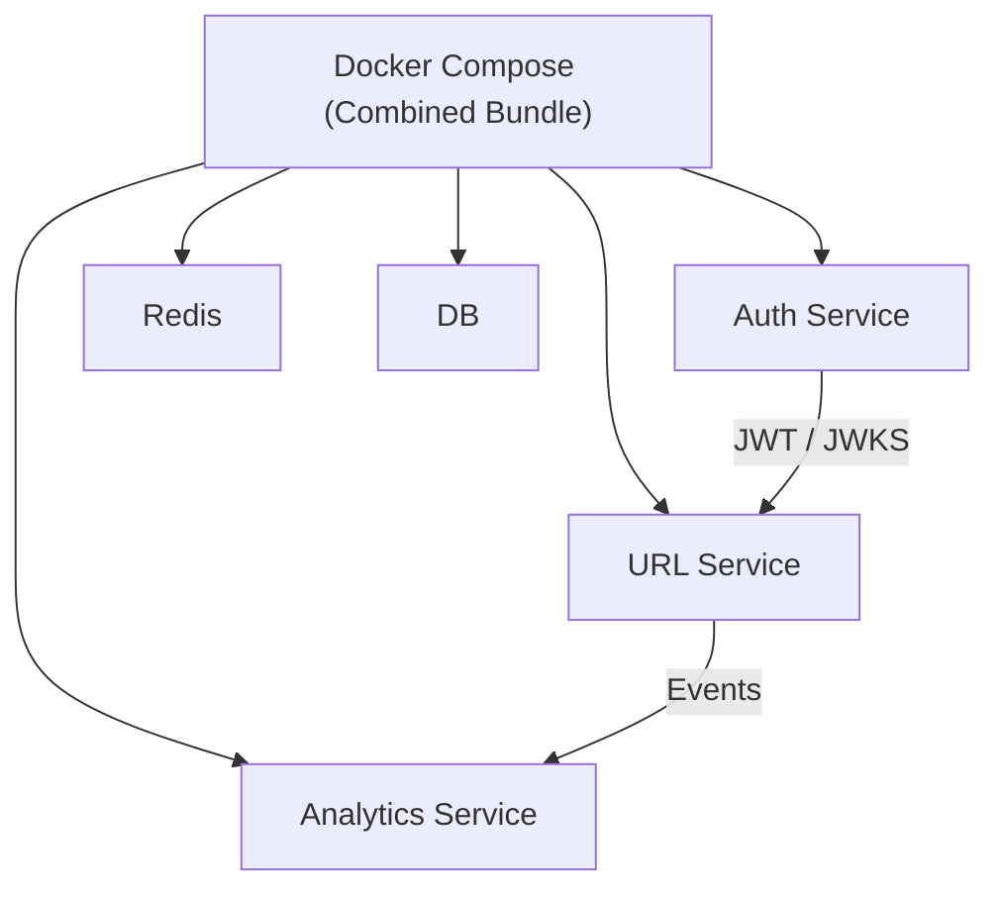

# Microservices Architecture and Security

## Application-Level Security (Must-Have)

Authentication and authorization
- JWT access tokens with short TTL
- Refresh tokens with rotation + revocation list
- Role-based access for admin endpoints
- Auth middleware validates JWT signature and claims

Input and data validation
- Validate URLs strictly (scheme + length + denylist)
- Validate payload types and sizes
- Reject malformed IDs early

Rate limiting and abuse protection
- Per-IP and per-user rate limiting
- Separate limits for create vs redirect
- Captcha for signup on suspicious traffic

Session and cookie security
- HttpOnly + Secure + SameSite=strict cookies for web UI
- CSRF protection for form POSTs
- Rotate session tokens after login

Secrets management
- Store secrets in environment or managed secret store
- Never commit secrets
- Rotate keys periodically

Transport security
- TLS everywhere (no HTTP)
- Strict-Transport-Security header

Logging and monitoring
- Structured logs with request ID
- Security events audit log (login failures, lockouts)
- Alerting on spikes

Dependency security
- Pin dependency versions
- Regular vulnerability scans

## Microservices Architecture

Core services
- Auth Service: signup/login/refresh, issues JWT
- URL Service: create/redirect, owns URL data
- Analytics Service: consumes events, aggregates metrics

Shared components
- Redis: cache hot redirects
- Database: URLs + users + analytics
- Queue: async analytics events

## High-Level Architecture

## Service Connectivity

Auth integration pattern
- Auth service exposes /login, /signup, /refresh
- Other services verify JWT with shared secret or JWKS
- Prefer JWKS so URL service never needs auth secrets

Internal communication
- Services talk over private network
- Use service discovery or fixed internal DNS names
- Optionally mTLS for service-to-service security

Event flow for analytics
- URL service emits event to queue on redirect
- Analytics service aggregates into metrics tables

## Deploy Together vs Individually

Combined (single distributable)
- Docker Compose for unified bundle
- One repo, multiple images
- Single command to spin everything up

Individually (each service as container)
- Each service has its own Dockerfile
- Own env config
- Own deployment pipeline
- Works standalone (Auth can be reused elsewhere)

## Combined vs Individual Diagram

## Documentation Checklist

- Architecture overview
- Service responsibilities
- Authentication flow
- Data flow (redirect + analytics)
- Shared components
- Local dev setup
- Deployment guide
- Security checklist
